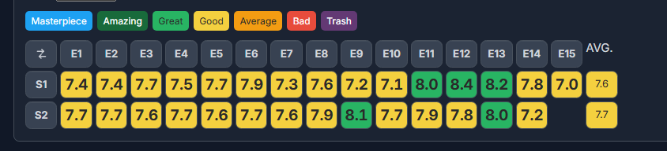

# Embergrid

An episode ratings heatmap for **Jellyfin Web**, installed through [JavaScript Injector](https://github.com/n00bcodr/Jellyfin-JavaScript-Injector).

A collapsible, accessible ratings table appears between Seasons and Cast. Open it to fetch ratings. Use the top-left switch to swap seasons and episodes. There is no separate view selector.

## Screenshots

Episodes run across the top. The last cell on each row is that season's average, counted from rated episodes only. The corner button swaps seasons and episodes.



[Troubleshooting](docs/TROUBLESHOOTING.md) · [Publishing](docs/PUBLISHING.md) · [Changelog](CHANGELOG.md)

## Features

- Stepped heatmap colors and a compact legend.
- One table with horizontal/vertical axis switching; preference saved in the browser.
- Season averages calculated from all rated episodes, with displayed color matching the displayed rounded score.
- Episode and season links to your Jellyfin library, with IMDb season links as fallback.
- Episode metadata tooltips on mouse hover, touch-and-hold, and keyboard focus, including rating-source information.
- Closed by default to keep ratings hidden until you choose to open them.
- Cached metadata and ratings, isolated by server, web path and user.
- Fallback to local Jellyfin ratings when IMDb lookup or dataset access fails, without hiding the grid; optional source failures can be retried.
- 15-second timeouts for Jellyfin API requests and external dataset fetches, with visible retry controls.
- Native table semantics, responsive horizontal scrolling, visible keyboard focus, and a labeled axis switch.
- Render-size limits for huge series, efficient episode lookups, and event-driven navigation reconciliation.
- No build step, account, API key or npm installation needed to use the script.

## Requirements and compatibility

- A Jellyfin server with [JavaScript Injector](https://github.com/n00bcodr/Jellyfin-JavaScript-Injector) installed and working.
- A browser/client using Jellyfin Web and allowing the injected code to run. Native clients that do not load Jellyfin Web are outside scope.
- A modern browser with `fetch`, `AbortSignal.timeout`, local/session storage and native HTML tables.
- Series pages with season cards. Movies and individual episode pages are not targets.
- Internet access to jsDelivr for optional external IMDb ratings. Local Jellyfin episode data still works when jsDelivr is unavailable.

The user confirmed that the v3 predecessor mounted successfully in a local Jellyfin instance and supplied grid/list/wrapped screenshots. Later revisions removed the additional views. Exact Jellyfin, plugin and browser versions were not recorded; this is not a version-by-version compatibility certification.

## Install: paste the complete script (recommended)

1. Install JavaScript Injector using its own instructions and restart Jellyfin if required by the plugin.
2. Open **Dashboard → JavaScript Injector / JS Injector**.
3. Disable/remove any previous episode-ratings loader or script to avoid competing implementations.
4. Add a script named **Embergrid**.
5. Open [Jellyfin-Embergrid-Episode-Ratings.js](Jellyfin-Embergrid-Episode-Ratings.js), select **Raw**, and copy the entire contents into **JavaScript Code**. Do not include Markdown fences or HTML script tags.
6. Enable the entry and save. If your plugin exposes a Script URL field, leave it empty for this installation method. This script is not an ES module.
7. Refresh Jellyfin with **Ctrl+F5**, open a series with seasons, and expand **IMDb Episodes Grid**.

Pasting the complete file needs **no hosting**. To update, replace the pasted contents with the newer version and refresh. Validate in your Jellyfin installation before publishing.

## Optional: load from your GitHub repository

After publishing your own repository, follow [the publishing guide](docs/PUBLISHING.md). The optional [loader template](examples/cdn-loader.js) points at your published script and prevents duplicate downloads. Configure its repository and tested revision before use. It is an alternative to full-file pasting, not an additional script to enable alongside it.

## Configuration

Edit the `CONFIG` object near the top before pasting:

| Option | Default | Purpose |
| --- | --- | --- |
| TITLE | IMDb Episodes Grid | Collapsible section heading |
| EMPTY_TEXT | No ratings available for this series. | No-data message |
| DEBUG | false | Temporary on-screen mount diagnostics |
| TOOLTIP | true | Metadata tooltips |
| TOOLTIP_DELAY_MS | 800 | Mouse hover delay |
| TOOLTIP_WIDTH_PX | 400 | Tooltip width, capped to viewport |
| CACHE_MINUTES | 120 | Browser-tab cache lifetime |
| MAX_SEASONS | 500 | Highest included season number |
| MAX_EPISODE_SPAN | 200 | Extra episode indices allowed for a combined file |
| MAX_EPISODE_NUMBER | 2000 | Maximum accepted numbered episode index |
| MAX_GRID_CELLS | 12000 | Approximate maximum episode-rating cells displayed |
| LOCAL_TIMEOUT_MS | 15000 | UI timeout per Jellyfin API request (ms) |
| EXTERNAL_TIMEOUT_MS | 15000 | External IMDb dataset timeout (ms) |
| DATASET_URL | ya0903 dataset on jsDelivr | External per-show ratings JSON folder |

The default request timeouts are 15 seconds. A Jellyfin timeout bounds waiting in the UI but does not cancel the underlying ApiClient request. Specials (season 0) are excluded. The axes choice is stored in the browser under `jf-imdb-episodes-grid-inverted-v1`.

## Rating colors

| Rating | Legend | Color |
| --- | --- | --- |
| 9.6–10 | Masterpiece | Blue |
| 9.0–9.5 | Amazing | Dark green |
| 8.0–8.9 | Great | Green |
| 7.0–7.9 | Good | Yellow |
| 6.0–6.9 | Average | Orange |
| 5.0–5.9 | Bad | Red |
| Below 5 | Trash | Purple |

Missing ratings appear as an em dash and do not count toward averages. Averages are simple arithmetic means, rounded for display; they are not weighted by votes. The rating color of an average is calculated from that same rounded display value. Each rated episode label includes the rating source (IMDb or Jellyfin); mixed-source season averages are identified. A combined episode file may represent multiple numbered episodes.

## Data and privacy

On expansion, the script reads the current show's IMDb provider ID and episode/season metadata through your authenticated Jellyfin client. When an IMDb ID exists, it fetches the matching show JSON from [ya0903/imdb-episode-dataset](https://github.com/ya0903/imdb-episode-dataset) through jsDelivr. Dataset ratings take precedence; Jellyfin CommunityRating is the fallback and is **not guaranteed to be an IMDb score**. If the external source fails, the table can still display locally available Jellyfin ratings, plus a retry notice. Averages can mix sources; the source is identified in labels and accessible descriptions.

The external request contains the IMDb show ID, not your Jellyfin token or user ID. It uses `credentials: omit`. As with normal HTTPS requests, the dataset host can see connection metadata such as your IP address. A CDN-loader installation also contacts the script CDN at page load. There is no added telemetry.

Browser session storage contains cached metadata/ratings; local storage stores the axes preference. These stores are readable by other scripts running on the same origin. Metadata tooltips request additional information from your Jellyfin server.

## Known limitations

- Jellyfin DOM/custom-theme changes may require selector updates.
- Dataset season numbering can differ from your library; additional dataset-only episode cells can appear. This is not a guarantee of a playable local episode or perfect anime ordering.
- The grid falls back to IMDb season pages when a local target is unavailable.
- External dataset/metadata failures show a retry notice while preserving locally available ratings. If no usable data source succeeds, an error with Retry is shown.
- In exceptionally large series, only the first episode numbers that fit the configured cell limit are shown; averages still include all rated episodes.
- DOM updates and Jellyfin navigation events trigger reconciliation; a 30-second fallback only checks visible pages where the block is missing. Updating installed code requires a full refresh.
- A successful network download does not prove the grid initialized. See troubleshooting.

## Development and validation

Use **Node.js 22 or newer**. No dependencies need installing.

```sh
npm run check
npm test
```

Automated tests cover rating, cache, and failure behavior with mocks. They do not certify layout, accessibility, or a live Jellyfin server. Verify the renderer and fallback logic in Jellyfin before relying on a new release.

See [CONTRIBUTING.md](CONTRIBUTING.md) for manual validation before releasing.

## Credits and license

Thanks to n00bcodr for JavaScript Injector and ya0903 for the ratings dataset. Tooltip behavior includes work credited to grimmdev. License provenance is in [NOTICE.md](NOTICE.md). This project is not affiliated with Jellyfin or IMDb.

Distributed under the [MIT license](LICENSE), retaining the original copyright. See [NOTICE.md](NOTICE.md) for provenance. External services and data retain their own terms.
